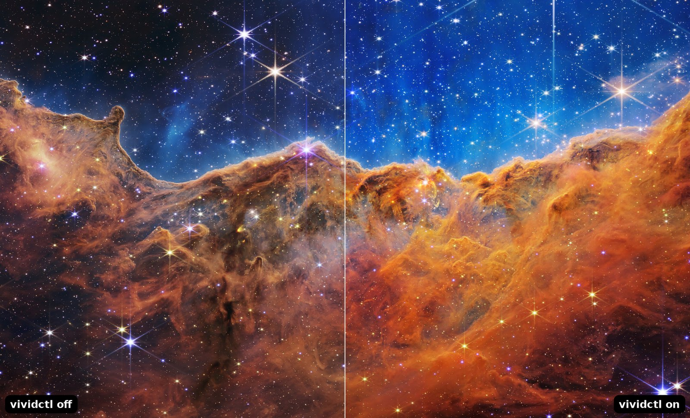
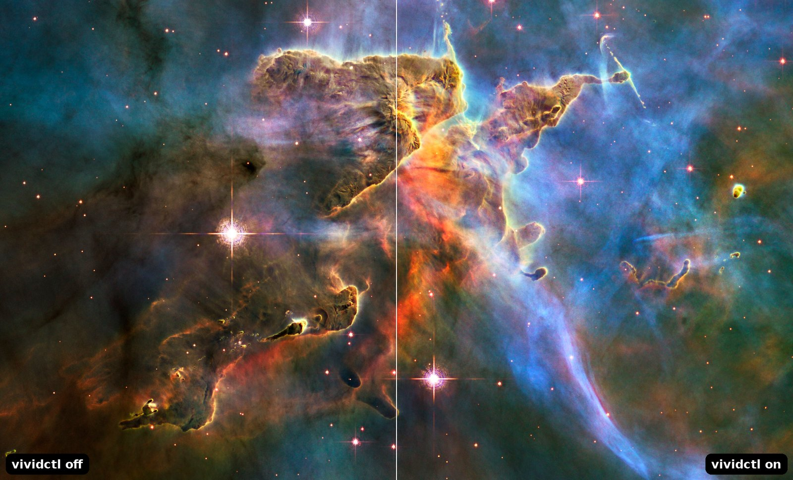
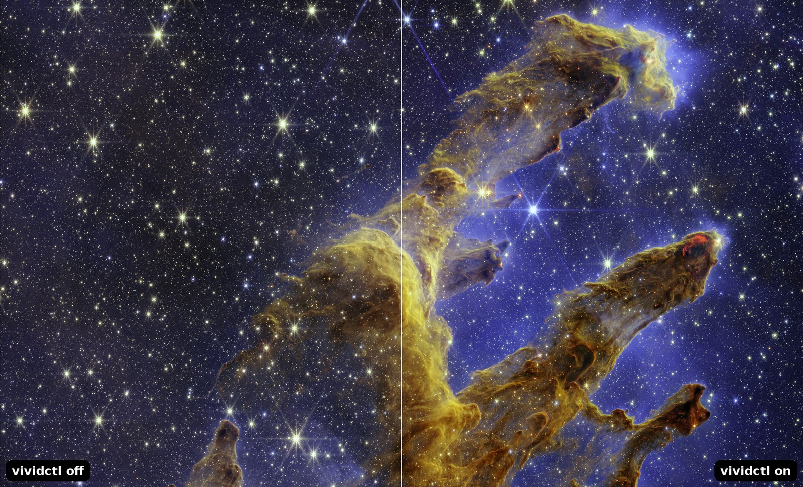

<h1 align="center">vividctl</h1>

<p align="center">
  <b>Digital Vibrance for Linux on Wayland.</b><br>
  Make colours pop in games, video and on the desktop, from one small command.
</p>

<p align="center">
  <a href="https://github.com/RGomes98/Vividctl/actions/workflows/ci.yml"></a>
  <a href="LICENSE"></a>
</p>

<p align="center">
  
  <br>
  <sub>Left: off. Right: <code>vividctl set 400</code>. See <a href="#see-it">how these were made</a>.</sub>
</p>

> **Status:** early development, before 0.1.0. It already sets, reads and resets the vibrance of NVIDIA monitors and of the internal panel of a hybrid laptop (GNOME). It does not save your choice yet, so the value does not survive a logout; see [what is left for 0.1.0](ROADMAP.md#release-plan-v010). There are no releases yet: build from source, it takes about a minute.

## Why

NVIDIA's Digital Vibrance slider is the quickest way to make a dull monitor look alive, and it is a favourite for games. On Linux with Wayland, `nvidia-settings` cannot change it. On a laptop with an NVIDIA GPU it is worse: the internal panel is usually driven by the Intel or AMD GPU, which NVIDIA's control cannot reach at all.

`vividctl` fixes both, from the terminal and without a resident process.

- **Real Digital Vibrance on Wayland.** For monitors an NVIDIA GPU drives, it sets NVIDIA's own control through the driver, with no per-driver build. It reads the running driver version, checks the interface before writing and reads every change back.
- **The laptop panel too.** For everything else, a small GNOME Shell extension applies the saturation inside the compositor. `vividctl extension install` sets it up.
- **Games and video, not just the desktop.** See [below](#does-it-work-in-games).
- **Nothing keeps running.** You run a command, the change is made, the process ends.
- **Small.** The binary is about 1.1 MiB, with 25 crates in the whole dependency tree, and a budget in CI keeps it there.
- **Built to survive driver updates.** Ten known interface layouts cover drivers 535 to 615. A driver newer than that is validated before anything is written, and refused if nothing fits.

## See it

<table>
  <tr>
    <td align="center" width="50%"><br><sub><b>Mystic Mountain</b> (Hubble)</sub></td>
    <td align="center" width="50%"><br><sub><b>Pillars of Creation</b> (Webb)</sub></td>
  </tr>
</table>

These are the real extension and the real `vividctl`, set to 400, captured in a test GNOME Shell with the half-and-half join done afterwards. The pictures are public-domain NASA images; see [docs/assets/CREDITS.md](docs/assets/CREDITS.md). A screenshot can only show the GNOME backend: on an NVIDIA monitor the change happens in the display hardware, after the screenshot is taken, so a photo of the screen is the only way to capture it.

## Does it work in games?

That is what it is for.

- **On an NVIDIA monitor** the change is applied by the display hardware, after the compositor, so it affects everything that monitor shows. By design this includes games and fullscreen video. It has been checked on the desktop with a visual test; a dedicated game run through this path is still on the list ([ADR-0001](docs/adr/0001-nvkms-pure-rust.md) says so).
- **On the laptop panel, through the GNOME extension**, it has been checked with a fullscreen game (Left 4 Dead 2) and with fullscreen video (VLC). Fullscreen windows normally skip the compositor, so while a boost is active the extension makes them go through it, and it stops doing so as soon as the monitor is back to neutral. Measured on a GTX 1660 Ti with a fullscreen game, that cost about one percentage point of GPU. Latency and VRR were not measured.

Neither path touches the game process: nothing is injected into it and no overlay is drawn over it.

## Quick start

```
sudo apt install build-essential pkg-config libdbus-1-dev
git clone https://github.com/RGomes98/Vividctl.git && cd Vividctl
cargo build --release -p vivid-cli
install -m 755 target/release/vividctl ~/.local/bin/vividctl

vividctl list                          # what it found, and which backend controls each output
vividctl set 300 --output HDMI-0       # -1024 (washed out) to 1023 (saturated), 0 is neutral
vividctl reset
```

For the internal panel of a laptop, or any output the NVIDIA GPU does not drive, also run `vividctl extension install` and log in again once. A good first value is 200 to 300.

The [user guide](docs/user-guide.md) has the rest: requirements, applying a value at every login, troubleshooting, uninstalling.

## Commands

```
vividctl list [--json]                       # outputs, their state, vibrance and monitor identity
vividctl get [--output MONITOR]              # current vibrance
vividctl set VALUE [--output MONITOR]        # -1024 to 1023, 0 is neutral
vividctl reset [--output MONITOR]            # back to neutral
vividctl extension install | status | remove # the GNOME Shell extension (then log in again)
```

`MONITOR` is the identity `list` shows, such as `PHL:PHL 242V8:0x00008fac` (it follows the monitor from port to port), or a connector name such as `HDMI-0`. Without `--output`, every connected output is used.

Coming next: `vividctl apply` (apply a saved profile at login), `preset`, `doctor` (diagnose the driver, the kernel module and hybrid setups) and a GTK4 GUI. See the [roadmap](ROADMAP.md).

## Which backend handles which monitor

Each monitor is handled once, by the first backend that sees it.

| Monitor                                                                                       | Backend | How                                                       |
| --------------------------------------------------------------------------------------------- | ------- | --------------------------------------------------------- |
| Driven by an NVIDIA GPU: a desktop monitor, or an external one on the NVIDIA port of a laptop | `nvkms` | NVIDIA's Digital Vibrance, through `/dev/nvidia-modeset`  |
| Anything else GNOME shows: the internal panel of a hybrid laptop                              | `gnome` | A saturation shader in GNOME Shell, controlled over D-Bus |

## Supported platforms

|               | Ubuntu 24.04 LTS | Ubuntu 26.04 LTS |
| ------------- | ---------------- | ---------------- |
| GNOME         | 46               | 50               |
| NVIDIA driver | 595 (tested)     | 580 (tested)     |
| Session       | Wayland          | Wayland          |

X11 is out of scope. The GNOME extension also runs in headless tests on Shell 48 and 49. KDE and other compositors are not supported yet: NVIDIA monitors work wherever the NVIDIA module is loaded, but the internal panel of a hybrid laptop needs the GNOME backend.

### What has been tested on real hardware

| Machine                                                                                                                  | What was exercised                                                                                                                                                                                                          |
| ------------------------------------------------------------------------------------------------------------------------ | --------------------------------------------------------------------------------------------------------------------------------------------------------------------------------------------------------------------------- |
| Desktop: GTX 1660 Ti, driver 595.99.02, Ubuntu 24.04, GNOME 46, monitor on HDMI                                          | NVKMS `list`, `get`, `set`, `reset` with a visual check; the Shell effect on a fullscreen game and on fullscreen video                                                                                                      |
| Hybrid laptop: Dell Inspiron 16 Plus 7640 (internal panel on the Intel GPU), driver 580.178.04, Ubuntu 26.04, GNOME 50.1 | The GNOME backend on the internal panel: `list`, `set` and `get`, with a visual check. The NVKMS layout for this driver is recognised, but `set` and `get` through it have not run: that needs a monitor on the NVIDIA port |

Everything else is covered by automated tests, including an emulated NVKMS driver and headless GNOME Shell 46 and 50 in CI. Reports from other hardware are welcome; see [CONTRIBUTING.md](CONTRIBUTING.md#hardware-reports).

## Documentation

| For                      | Read                                                                                                                 |
| ------------------------ | -------------------------------------------------------------------------------------------------------------------- |
| Users                    | [docs/user-guide.md](docs/user-guide.md), [extensions/gnome/README.md](extensions/gnome/README.md)                   |
| Contributors             | [CONTRIBUTING.md](CONTRIBUTING.md), [docs/architecture.md](docs/architecture.md)                                     |
| Why it is built this way | [docs/adr/](docs/adr/README.md) (decisions) and [docs/spikes/](docs/spikes/README.md) (the measurements behind them) |
| What is next             | [ROADMAP.md](ROADMAP.md), [CHANGELOG.md](CHANGELOG.md)                                                               |

## License

Apache-2.0. See [LICENSE](LICENSE) and [NOTICE](NOTICE). The images in `docs/assets/` are public-domain NASA photographs, credited in [docs/assets/CREDITS.md](docs/assets/CREDITS.md).
